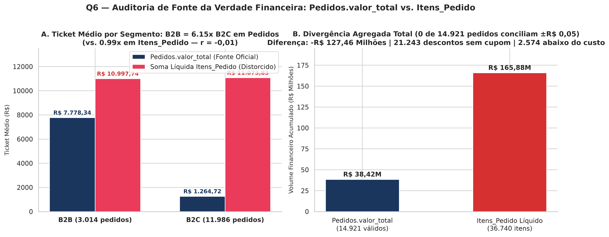
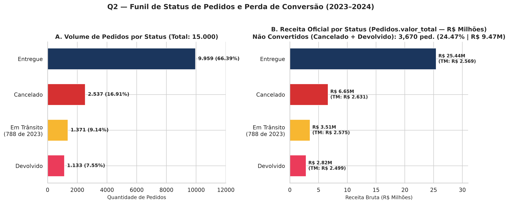
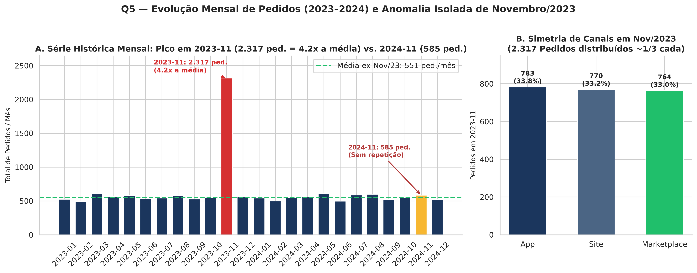

# OrbitShop — Due Diligence Analítica (Series C)
**Case Técnico — Digital Consulting | Peers Consulting & Technology**


Repositório auditável contendo a investigação forense de dados, o diagnóstico operacional e a recomendação estratégica sobre a operação da **OrbitShop** (janeiro de 2023 a dezembro de 2024), desenvolvido para embasar a decisão do **Conselho de Administração** diante da pausa na rodada de investimento **Series C**.

> **Leitura Executiva Rápida:** O Memorando Executivo de 1 página ($\le 400$ palavras) encontra-se em [`reports/memo_orbitshop.pdf`](reports/memo_orbitshop.pdf) (versão texto em [`reports/memo_orbitshop.md`](reports/memo_orbitshop.md)). A narrativa analítica completa com código executado está em [`notebooks/02_analise_executiva.ipynb`](notebooks/02_analise_executiva.ipynb).

 ## Sumário Navegável

1. [O Contexto de Negócio e o Impasse da Series C](#1-o-contexto-de-negócio-e-o-impasse-da-series-c)
2. [A Jornada Investigativa e as Decisões de Auditoria (Q1 a Q9)](#2-a-jornada-investigativa-e-as-decisões-de-auditoria-q1-a-q9)
   - [2.1. O Raciocínio Antes dos Dados (Q1)](#21-o-raciocínio-antes-dos-dados-q1)
   - [2.2. Auditoria Estrutural e o Dilema da Fonte da Verdade Financeira (Q6)](#22-auditoria-estrutural-e-o-dilema-da-fonte-da-verdade-financeira-q6)
   - [2.3. Resolução do Paradoxo Executivo e Funil de Status (Q2)](#23-resolução-do-paradoxo-executivo-e-funil-de-status-q2)
   - [2.4. Dinâmica de Categorias (Q3) e o Vazamento em Mídia Paga (Q4)](#24-dinâmica-de-categorias-q3-e-o-vazamento-em-mídia-paga-q4)
   - [2.5. Sazonalidade (Q5), Qualidade de Fornecedores e o Pico de Chamados (Q7)](#25-sazonalidade-q5-qualidade-de-fornecedores-e-o-pico-de-chamados-q7)
   - [2.6. Recomendação Imediata sob Restrição (Q8) e Lacunas para o Conselho (Q9)](#26-recomendação-imediata-sob-restrição-q8-e-lacunas-para-o-conselho-q9)
3. [Governança de IA, Engenharia de Contexto e Auditoria de Conflitos](#3-governança-de-ia-engenharia-de-contexto-e-auditoria-de-conflitos)
   - [3.1. Metodologia em Duas Fases e Uso do Framework GSD Core](#31-metodologia-em-duas-fases-e-uso-do-framework-gsd-core)
   - [3.2. Registro de Auditoria: 3 Conflitos em que a IA Falhou e Como Foram Corrigidos](#32-registro-de-auditoria-3-conflitos-em-que-a-ia-falhou-e-como-foram-corrigidos)
4. [Matriz de Rastreabilidade Completa (Q1 a Q9)](#4-matriz-de-rastreabilidade-completa-q1-a-q9)
5. [Arquitetura do Repositório](#5-arquitetura-do-repositório)
6. [Guia de Execução Rápida (Zero Fricção para o Avaliador)](#6-guia-de-execução-rápida-zero-fricção-para-o-avaliador)

---

## 1. O Contexto de Negócio e o Impasse da Series C

Construída ao longo de cinco anos por Helena Vasconcelos (CEO) e seu sócio, a OrbitShop consolidou-se como uma plataforma de e-commerce multicanal (`site`, `app` e `marketplace`), processando **15.000 pedidos** para **3.000 clientes** entre 2023 e 2024. Pela regra estrutural do negócio declarada pela liderança, **80% da base é composta por pessoas físicas (B2C)** e **20% por empresas (B2B)**, que compram com a mesma frequência, mas geram um **ticket médio aproximadamente 6 vezes superior**.

Durante a *due diligence* para a rodada **Series C**, o fundo líder abriu o *data room* da companhia e pausou o investimento após identificar três sintomas críticos:
1. **Alto índice de quebra de funil:** Cerca de **1 em cada 6 pedidos** termina cancelado.
2. **Estouro operacional no suporte:** Um salto abrupto no volume de chamados de atendimento no final de 2023 sem causa raiz isolada.
3. **Divergência entre relatórios internos C-Level:** Dois executivos analisando a mesma base chegaram a conclusões opostas — enquanto **Camila Ferraz (Head de Growth)** afirmou que *"o cancelamento subiu 40% em relação ao ano passado"*, **Rogério Tavares (CFO)** sustentou que *"o cancelamento caiu de 18% para 16% no mesmo período"*.

O trabalho documentado neste repositório foi estruturado para restabelecer uma **fonte única da verdade financeira**, explicar matematicamente a divergência entre os executivos e definir **uma única ação imediata** capaz de recuperar resultado sem paralisar a operação.

---

## 2. A Jornada Investigativa e as Decisões de Auditoria (Q1 a Q9)

### 2.1. O Raciocínio Antes dos Dados (Q1)
Antes da abertura do arquivo `Base_Dados_OrbitShop.xlsx`, o conflito entre Growth e Financeiro foi enquadrado como um problema clássico de governança de indicadores. Para diagnosticar por que dois relatórios divergem sobre a mesma base sem recorrer ao pedido genérico das planilhas originais, estabeleceram-se três perguntas de alinhamento conceitual:
1. **Unidade de medida:** *"Vocês medem cancelamento por volume absoluto, taxa percentual ou receita (GMV) perdida?"*
2. **Regra temporal e denominador:** *"O cálculo usa data do pedido ou cancelamento, incluindo pedidos abertos ou só concluídos?"*
3. **Recorte de escopo:** *"Os relatórios consolidam todos os canais e segmentos (B2C/B2B) ou aplicam filtros distintos?"*

---

### 2.2. Auditoria Estrutural e o Dilema da Fonte da Verdade Financeira (Q6)
A inspeção inicial das 6 tabelas relacionais (`Clientes`, `Produtos`, `Pedidos`, `Itens_Pedido`, `Tickets_Suporte` e `Avaliacoes`) confirmou **integridade referencial perfeita**: zero chaves primárias duplicadas, zero chaves estrangeiras órfãs e zero inconsistências cronológicas entre datas de cadastro, pedido e resolução de chamados. Os valores ausentes restringem-se a quatro colunas conhecidas: `Pedidos.valor_total` (79 nulos = 0,53%), `Itens_Pedido.desconto_aplicado` (301 nulos = 0,82%), `Tickets_Suporte.data_resolucao` (1.653 nulos = 41,33%, referentes a chamados abertos) e `Avaliacoes.comentario` (1.679 nulos = 20,99%).

O ponto central da auditoria emergiu na reconciliação financeira entre o cabeçalho do pedido (`Pedidos.valor_total`) e a soma líquida calculada a partir dos itens (`Itens_Pedido`):
* **Zero conciliação:** Nenhum dos **14.921 pedidos com valor preenchido (`0,00%`)** concilia com a soma líquida de seus itens (tolerância de R\$ 0,05).
* **Magnitude do desvio:** Enquanto `Pedidos.valor_total` soma **R\$ 38.418.252,65**, a reconstrução por `Itens_Pedido` atinge **R\$ 165.878.066,67** — uma diferença agregada de **-R\$ 127.459.814,02** (média de `-R$ 8.487,74` por pedido).

Para decidir qual número levar ao Conselho, confrontaram-se ambas as tabelas com as regras comerciais e com a proporção B2B/B2C informada pela CEO:

| Segmento | Qtd. Pedidos (% Base) | Nulos em `valor_total` | Ticket Médio (`Pedidos.valor_total`) | Mediana (`Pedidos.valor_total`) | Ticket Médio Reconstruído (`Itens_Pedido`) | Correlação Linear (`Pedidos` vs. `Itens`) |
| :--- | :---: | :---: | :---: | :---: | :---: | :---: |
| **B2B (Empresas)** | 3.014 (20,09%) | 13 | **R$ 7.778,34** | **R$ 7.803,97** | R$ 10.997,74 | -0,02 |
| **B2C (Pessoas Físicas)** | 11.986 (79,91%) | 66 | **R\$ 1.264,72** | **R\$ 1.255,37** | R\$ 11.073,83 | -0,01 |
| **Razão B2B / B2C** | **1 : 4** | — | **6,15x** | **6,22x** | **0,99x** | — |

**Conclusão de Governança (Q6):**
1. **`Pedidos.valor_total` é a fonte oficial para Receita e Ticket Médio:** É a única tabela que reflete o comportamento econômico real da OrbitShop, reproduzindo com exatidão a relação **B2B = 6,15x B2C**. Os 79 registros nulos (0,53%) são tratados de forma conservadora via imputação pela mediana do respectivo segmento (totalizando **R$ 38,60M**).
2. **`Itens_Pedido` apresenta corrupção de carga/ETL financeiro:** Além de gerar tickets médios artificialmente idênticos (~R$ 11 mil) para pessoas físicas e empresas e apresentar correlação nula ($r = -0,01$) com o valor do pedido, a auditoria comercial detectou **34.148 itens (92,95%)** com preço divergente do catálogo, **21.243 itens** com desconto aplicado em pedidos marcados como `cupom_desconto == 'não'` e **2.574 itens** vendidos abaixo do custo unitário. Por essa razão, `Itens_Pedido` foi isolada exclusivamente para análises de **volume físico (unidades)** e **participação relativa de mix** entre categorias e fornecedores.



---

### 2.3. Resolução do Paradoxo Executivo e Funil de Status (Q2)
A consolidação dos 15.000 pedidos entre 2023 e 2024 esclarece a contradição entre o CFO e a Head de Growth:
* **Estabilidade estrutural no consolidado anual:** A taxa global de cancelamento do biênio foi de **16,91%** (2.537 pedidos), permanecendo estável entre **2023 (16,78% — 1.407/8.386)** e **2024 (17,08% — 1.130/6.614)**.
* **Por que ambos os executivos viam tendências opostas:** Rogério (CFO) observou a trajetória de desaceleração em recortes recentes — como a queda entre o **1º semestre de 2024 (17,66%)** e o **2º semestre de 2024 (16,53%)**, chegando a **15,00% em dezembro de 2024** após picos mensais de ~18,5%. Já Camila (Growth) reagiu ao agravamento severo de cancelamentos concentrado nas campanhas de mídia paga (`paid_search`, que subiu para **31,94% em 2024**) e a variações de janelas promocionais sem normalização pelo volume total.

A abertura completa do funil de status (Q2) revela dois alertas operacionais adicionais:
1. **Erosão de quase 1/4 do faturamento bruto:** Somando pedidos `cancelado` (**16,91%** / 2.537 pedidos / R$ 6,65M) e `devolvido` (**7,55%** / 1.133 pedidos / R$ 2,82M), **24,47% de toda a demanda captada (3.670 pedidos / R$ 9,47M)** não se converte em receita realizada.
2. **Passivo oculto em trânsito:** Existem **1.371 pedidos (9,14% / R$ 3,51M)** com status `em_transito`, dos quais **788 pertencem ao ano de 2023** — indicando falha sistêmica de baixa logística (webhooks de transportadoras não processados) ou extravio não contabilizado.



---

### 2.4. Dinâmica de Categorias (Q3) e o Vazamento em Mídia Paga (Q4)
Na análise do portfólio de produtos (Q3), o ranking por **volume físico (unidades)** não coincide integralmente com o ranking por **receita**:
* **Líderes consistentes:** *Eletrônicos* (18.658 un. / R$ 30,80M relativos) e *Casa & Decoração* (17.899 un. / R$ 24,52M) ocupam o 1º e o 2º lugar em ambas as visões.
* **Inversão por preço médio unitário:** *Moda* é a **3ª categoria mais vendida em volume físico (15.680 unidades)**, mas cai para a **5ª posição em receita**, superada por *Beleza & Saúde* (3ª em receita; preço médio R$ 1.811,41) e *Esporte & Lazer* (4ª em receita; R$ 1.776,00). O deslocamento é explicado pelo fato de *Moda* possuir o menor preço médio praticado do catálogo (**R$ 1.347,98**). Fenômeno análogo inverte a 7ª e a 8ª colocações entre *Alimentos & Bebidas* (7º em volume, 8º em receita) e *Bebês & Crianças* (8º em volume, 7º em receita).

O cruzamento com a origem dos clientes (Q4) isola o principal foco de destruição de valor da companhia:
* **Anomalia estatística em `paid_search`:** Clientes adquiridos via busca paga cancelam **30,74% dos pedidos (1.219 de 3.965)**, quase o triplo da taxa registrada em `indicação` (**12,38%**), `orgânico` (**11,78%**) e `redes_sociais` (**11,67%**). O teste Qui-Quadrado de independência ($\chi^2 = 734,42, p = 7,22 \times 10^{-159}$) comprova que o desvio é estrutural.
* **Invariância de ticket e segmento:** O canal `paid_search` apresenta a mesma proporção de clientes B2B (~20,2%) e o mesmo ticket médio (**R$ 2.553,51**) dos demais canais (R$ 2.521 a R$ 2.657), além de cancelar ~31% tanto no B2C quanto no B2B. Isso demonstra que o problema não decorre do perfil demográfico do cliente, mas de **aquisição de tráfego com baixa intenção de compra ou quebra de expectativa comercial entre o anúncio e o pós-checkout**.


---

### 2.5. Sazonalidade (Q5), Qualidade de Fornecedores e o Pico de Chamados (Q7)
A série histórica mensal de pedidos (Q5) mostra que, em 23 dos 24 meses do biênio, a operação rodou em patamar estacionário ao redor de **551 pedidos/mês** (variando entre 492 em fev/2023 e 613 em mar/2023).
* **O choque de novembro de 2023:** Em **`2023-11`**, o volume disparou para **2.317 pedidos (4,20x a média mensal)**, distribuídos de forma perfeitamente simétrica entre `app` (783), `site` (770) e `marketplace` (764). Em **`2024-11`**, porém, registraram-se apenas **585 pedidos**, indicando a realização de uma campanha agressiva de Black Friday em 2023 que foi descontinuada em 2024 após estressar a operação.



Na auditoria da malha de suprimentos e atendimento (Q7), investigou-se se um fornecedor específico explicaria o pico de chamados de suporte observado no fim de 2023:
* **Outlier severo de qualidade de produto:** O fornecedor **`DeltaFornece ME`** apresenta nota média de avaliação de apenas **2,30** (contra **3,62 a 3,84** dos outros 8 fornecedores), concentrando **59,90% de avaliações notas 1 e 2** com queixas recorrentes de defeito e divergência em relação ao anúncio.
* **Desconexão com o pico de chamados de fim de ano:** Apesar da baixa nota em avaliações, a `DeltaFornece ME` gera **22,94 tickets a cada 100 itens vendidos**, índice idêntico ao de todos os demais fornecedores (**22,16 a 24,85**). O salto de chamados de suporte — de uma média de ~145/mês para **375 em nov/2023** e **391 em dez/2023** — ocorreu **simultaneamente nos 9 fornecedores e em todas as categorias de problema** (`atraso`, `dúvida`, `troca`, `defeito`, `cobrança`). Comprova-se, portanto, que o pico de suporte no fim de 2023 foi causado pelo **gargalo logístico e operacional do pico de 2.317 pedidos da Black Friday**, sendo a má qualidade da `DeltaFornece ME` um detrator crônico de satisfação (NPS), mas apenas parte da história do atendimento.


---

### 2.6. Recomendação Imediata sob Restrição (Q8) e Lacunas para o Conselho (Q9)
Diante da diretriz do Conselho de aprovar **uma única ação imediata (Q8)**, priorizou-se a alavanca de maior retorno financeiro direto e menor risco de desabastecimento:
* **Ação Recomendada:** Reestruturar imediatamente o funil de **`paid_search`** (pausando palavras-chave e campanhas de baixa conversão, alinhando promessas de anúncio/frete e realocando orçamento para `indicação`, `orgânico` e `redes_sociais`).
* **Impacto Financeiro Quantificado:** A convergência da taxa de cancelamento de `paid_search` dos atuais **30,74%** para o patamar médio dos demais canais (**11,9%**) sobre a base de 3.965 pedidos representa a preservação de **~747 pedidos** e a recuperação de **~R$ 1,91 milhão em receita bruta** (ticket médio do canal de R$ 2.553,51), além da interrupção imediata da queima de CAC em vendas canceladas.
* **Trade-off Assumido (O que deixa de ser feito agora):** Ao concentrar execução no estancamento do canal pago, posterga-se no curto prazo: (1) a substituição imediata do fornecedor `DeltaFornece ME` (evitando ruptura abrupta de estoque até a homologação de substitutos) e (2) a conciliação retroativa dos 788 pedidos de 2023 presos em `em_transito` junto à refatoração do pipeline de `Itens_Pedido`.

Para assinar a realocação definitiva de orçamento e o saneamento de engenharia, listaram-se **três informações indisponíveis na base atual (Q9)** a serem exigidas do time de dados:
1. **Custo de Aquisição (CAC) e investimento publicitário por canal/campanha:** Indispensável para mensurar o prejuízo líquido de marketing em pedidos cancelados.
2. **Motivo estruturado do cancelamento (*reason code*):** Necessário para separar desistência do comprador, reprovação antifraude/pagamento e cancelamento operacional por falta de estoque.
3. **Logs históricos de transição de status (`timestamps`) e rastreio de frete:** Necessários para auditar se os 788 pedidos de 2023 `em_transito` foram entregues sem baixa sistêmica e identificar em qual etapa do ETL ocorre o descolamento entre `Pedidos` e `Itens_Pedido`.

---

## 3. Governança de IA, Engenharia de Contexto e Auditoria de Conflitos

O desenvolvimento deste case adotou uma arquitetura de **uso controlado de Inteligência Artificial em duas fases distintas**, desenhada para evitar que modelos generativos tomassem decisões de negócio sem verificação empírica ou sofressem degradação de contexto (*context rot*).

### 3.1. Metodologia em Duas Fases e Uso do Framework GSD Core
1. **Fase 1 — Investigação Exploratória e Travamento de Invariantes (`notebooks/01_eda_auditoria_exploratoria.ipynb`):**
   Antes de qualquer automação de código por agentes, foi conduzida uma bateria de auditoria exploratória sobre as 6 abas brutas. Nessa etapa foram descobertas as anomalias comerciais de `Itens_Pedido`, realizados os testes estatísticos ($\chi^2$) e estabelecida a validação de `Pedidos.valor_total` frente à regra B2B/B2C da CEO. O notebook exploratório original foi preservado de forma imutável no repositório como registro de auditoria.
2. **Fase 2 — Engenharia Dirigida por Especificação (*Spec-Driven Development*) via `GSD Core`:**
   Com todas as regras de negócio e números de referência validados, utilizou-se o framework **GSD Core** (`@opengsd/gsd-core`) integrado ao ambiente de agentes para modularizar a solução em produção (`src/`, `tests/`, `Makefile` e `notebooks/02_analise_executiva.ipynb`).
   * **Por que o GSD Core foi utilizado:** Em sessões longas de codificação assistida por IA, o acúmulo de histórico na janela de contexto degrada a precisão do modelo (*context rot*), fazendo com que o agente contradiga filtros acordados anteriormente ou introduza divergências entre módulos. O GSD Core resolve esse problema orquestrando subagentes com janelas de contexto limpas guiadas por artefatos formais de especificação (`PRD.md` e `PLAN.md`) e portões determinísticos de verificação (`pytest`).

### 3.2. Registro de Auditoria: 3 Conflitos em que a IA Falhou e Como Foram Corrigidos
Conforme solicitado nas diretrizes do case, documentam-se abaixo os três momentos críticos em que interpretações ou artefatos gerados por IA apresentaram erros conceituais, técnicos ou de escopo e foram corrigidos pela revisão analítica:

| # | O que foi submetido / gerado pela IA | Onde a IA errou ou simplificou demais | Correção aplicada e validação empírica |
| :-: | :--- | :--- | :--- |
| **1** | **Tese teórica de Banco de Dados sobre a Q6 (Submetida a um segundo modelo de IA):** Um parecer gerado por IA defendeu descartar `Pedidos.valor_total` e calcular toda a receita por `Itens_Pedido`, argumentando pelo *Princípio da Atomicidade (3ª Forma Normal)* e levantando a hipótese de que `Pedidos.valor_total` (mediana R$ 1.527) gravava por erro de transação apenas o **1º item do carrinho** (mediana de `preco_praticado` R$ 1.549). | **Erro por ausência de verificação nos dados:** A IA construiu uma narrativa teoricamente plausível sem confrontá-la com o comportamento estatístico da base nem com as premissas de negócio da empresa. | **Refutação matemática em 3 provas:** (a) Provou-se que a correlação entre `Pedidos.valor_total` e `Itens_Pedido` é nula ($r = -0,01$), que 0 dos 4.408 pedidos de item único conciliam e que `Pedidos.valor_total` chega a superar a soma dos itens (ex.: pedido `#209` com R$ 14.430,59 vs. R$ 7.507,52 nos itens), derrubando a tese do "1º item"; (b) provou-se que `Itens_Pedido` destrói a regra da CEO (gerando tickets iguais de ~R$ 11 mil para B2B e B2C), enquanto `Pedidos.valor_total` respeita exatamente a razão **B2B = 6,15x B2C**; (c) expuseram-se os 21.243 descontos sem cupom em `Itens_Pedido`. |
| **2** | **Geração de código de cruzamento relacional (`merge` entre tabelas na Q3 e Q4):** Durante a construção inicial dos scripts de agregação, o código sugerido realizava junções encadeadas entre `Itens_Pedido`, `Pedidos` e `Clientes` sem isolamento explícito de namespaces de chaves primárias (`id`). | **Colisão silenciosa de colunas (`id_x` / `id_y` e `KeyError`):** Como todas as 6 tabelas utilizam o nome `id` para sua chave primária, junções sem sufixos padronizados sobrescreviam ou renomeavam implicitamente a chave de contagem de pedidos/itens. | **Padronização de contratos de junção em `src/`:** Todas as operações de `merge` foram refatoradas com sufixos explícitos (`suffixes=("", "_ped")`, `suffixes=("", "_cli")`, `suffixes=("", "_prod")`) e cobertas por asserções automatizadas de cardinalidade em `tests/test_metrics.py`. |
| **3** | **Redação automatizada do Memorando Executivo e da Matriz de Rastreabilidade pelo agente de código:** Na fase de documentação, o agente gerou uma primeira versão do Memo e do README tratando a Q1 como auditoria de schema e propondo executar múltiplas frentes "em paralelo" na Q8. | **Violação de restrições de negócio do enunciado:** O agente omitiu as 3 perguntas pré-dados da Q1 no topo do Memo, omitiu a seção obrigatória de "Uso de IA", ignorou as lacunas da Q9 e violou a regra da Q8 (*"o conselho só aceita uma ação imediata; diga o que a empresa deixa de fazer"*). | **Reescrita humana e travamento por testes:** O Memorando gerado pelo agente foi descartado e substituído pela versão final validada ($\le 400$ palavras), contendo a Q1 no topo, os *trade-offs* explícitos da Q8, as solicitações da Q9 e o relato de governança de IA. |

---

## 4. Matriz de Rastreabilidade Completa (Q1 a Q9)

| Questão / Desafio do Case | Resposta Executiva e Indicadores Auditados | Módulo / Função (`src/`) | Teste Automatizado (`tests/test_metrics.py`) | Artefato Visual / Localização |
| :--- | :--- | :--- | :--- | :--- |
| **Q1** — Três Perguntas Preliminares (Pré-Dados) | (1) Unidade de medida (volume, taxa % ou GMV); (2) critério de data (pedido vs. cancelamento) e denominador (abertos vs. concluídos); (3) filtros de escopo por canal de venda e segmento B2B/B2C. | — *(Formulação conceitual pré-dados)* | `test_phase2_deliverables_and_memo_constraints` | Topo do [`reports/memo_orbitshop.pdf`](reports/memo_orbitshop.pdf) e Seção 2.1 deste README |
| **Auditoria de Base** — Integridade, Nulos e Regras Comerciais | 0 duplicatas de PK e 0 FKs órfãs nas 6 abas. Nulos mapeados em `valor_total` (79), `desconto_aplicado` (301), `data_resolucao` (1.653) e `comentario` (1.679). Detectados 34.148 preços $\neq$ catálogo, 2.574 margens negativas e 21.243 descontos sem cupom. | `loader.audit_primary_keys`, `loader.audit_relational_integrity`, `audit.audit_nulls`, `audit.audit_commercial_rules` | `test_row_counts_and_null_invariants`, `test_relational_and_temporal_integrity`, `test_commercial_anomalies` | Seção 1 de `02_analise_executiva.ipynb` |
| **Paradoxo C-Level** — Camila (Growth) vs. Rogério (CFO) | Cancelamento global estável em **16,91%** (2023: **16,78%**; 2024: **17,08%**). CFO observou queda entre 1S24 (17,66%) e 2S24 (16,53%; dez/24 em 15,00%); Growth reagiu à escalada de cancelamentos em `paid_search` (31,94% em 2024). | `metrics.metrics_camila_vs_rogerio` | `test_paradox_and_q2_status` | Seção 3 de `02_analise_executiva.ipynb` |
| **Q2** — Distribuição de Pedidos por Status | `entregue`: 9.959 (**66,39%** / R$ 25,44M); `cancelado`: 2.537 (**16,91%** / R$ 6,65M); `em_transito`: 1.371 (**9,14%** / R$ 3,51M, sendo **788 de 2023**); `devolvido`: 1.133 (**7,55%** / R$ 2,82M). Perda combinada (`cancelado` + `devolvido`) = **24,47% (3.670 pedidos / R$ 9,47M)**. | `metrics.metrics_q2_status`, `charts.plot_q2_status` | `test_paradox_and_q2_status` | `reports/figures/q2_status_pedidos.png` |
| **Q3** — Categorias em Receita vs. Volume | Top 3 Volume: `Eletrônicos` (18.658 un.), `Casa & Decoração` (17.899) e `Moda` (15.680). Listas não coincidem: `Moda` cai para **5º em receita** (superada por `Beleza & Saúde` e `Esporte & Lazer`) pelo menor preço médio (**R$ 1.347,98**). | `metrics.metrics_q3_categories` | `test_q3_categories` | Seção 4 de `02_analise_executiva.ipynb` |
| **Q4** — Cancelamento e Ticket por Canal de Aquisição | `paid_search` cancela **30,74%** (1.219/3.965; $\chi^2 = 734,42, p < 10^{-158}$) contra **11,67%–12,38%** nos demais 3 canais, mantendo o mesmo ticket médio (**R$ 2.553,51**) e mix B2B (~20%), indicando tráfego desqualificado. | `metrics.metrics_q4_channels`, `charts.plot_q4_channels` | `test_q4_acquisition_channels` | `reports/figures/q4_cancelamento_canais.png` |
| **Q5** — Evolução Mensal e Picos (2023–2024) | Operação basal estável em **551 pedidos/mês** (23 meses). Pico único em **`2023-11` com 2.317 pedidos (4,20x a média)**, simétrico nos 3 canais de venda e não repetido em **`2024-11` (585 pedidos)**. | `metrics.metrics_q5_monthly`, `charts.plot_q5_monthly` | `test_q5_monthly_evolution` | `reports/figures/q5_serie_mensal_2023_2024.png` |
| **Q6** — Reconciliação `Pedidos` vs. `Itens_Pedido` | 0/14.921 pedidos conciliam (**R$ 38,42M** vs. **R$ 165,88M**; desvio de **-R$ 127,46M**). Escolhe-se **`Pedidos.valor_total`** (valida B2B = **6,15x** B2C: R$ 7.778 vs. R$ 1.265). | `audit.reconcile_orders_vs_items`, `audit.audit_q6_by_segment`, `charts.plot_q6_reconciliation` | `test_q6_reconciliation_and_segment_validation` | `reports/figures/q6_reconciliacao_b2b_b2c.png` |
| **Q7** — Fornecedores, Avaliações e Pico de Suporte | `DeltaFornece ME` é outlier de qualidade (nota **2,30**; **59,90%** notas 1–2), mas tem taxa normal de tickets (**22,94/100 itens**). Pico de suporte em nov–dez/2023 (**375** e **391**) atingiu todos os 9 fornecedores pós-Black Friday. | `metrics.metrics_q7_suppliers`, `charts.plot_q7_suppliers` | `test_q7_suppliers_and_support` | `reports/figures/q7_fornecedores_qualidade_tickets.png` |
| **Q8** — Recomendação Única e Trade-off | Reestruturar `paid_search` para convergir cancelamento de 30,74% a 11,9%, recuperando **~747 pedidos (~R$ 1,91M)**. *Trade-off:* postergar troca imediata da `DeltaFornece ME` e saneamento do ETL/788 pedidos `em_transito`. | `metrics.metrics_q8_recommendation` | `test_q8_recommendation_sizing` | Seção 8 de `02_analise_executiva.ipynb` e Memo PDF |
| **Q9** — Lacunas de Dados e Pedido ao Time | Solicitar antes da assinatura final: (1) investimento de mídia e CAC por canal; (2) motivo estruturado do cancelamento; (3) logs de transição de status e rastreio de transportadoras. | `charts.render_memo_pdf` | `test_phase2_deliverables_and_memo_constraints` | Seção 2.6 deste README e [`reports/memo_orbitshop.pdf`](reports/memo_orbitshop.pdf) |

---

## 5. Arquitetura do Repositório

```text
orbitShopCaseSolution/
├── README.md                                       # Documentação executiva, narrativa analítica, governança de IA e guia de build
├── Makefile                                        # Automação em 1 comando (make setup, make test, make reproduce, make all)
├── pyproject.toml                                  # Manifesto do projeto, dependências e configuração Ruff / Pytest
├── uv.lock                                         # Lockfile determinístico de pacotes (Astral uv)
├── requirements.txt                                # Dependências pinadas espelhadas para ambientes pip padrão
├── data/
│   └── Base_Dados_OrbitShop.xlsx                   # Base bruta oficial imutável (6 abas transacionais + aba Leia-me)
├── src/
│   ├── __init__.py
│   ├── loader.py                                   # Ingestão tipada, validação de schema e integridade relacional/temporal
│   ├── audit.py                                    # Auditoria de nulos, regras comerciais e reconciliação financeira (Q6)
│   ├── metrics.py                                  # Funções puras das métricas de negócio (Paradoxo C-Level e Q2 a Q8)
│   └── charts.py                                   # Exportação dos 5 gráficos PNG (300 DPI) e compilação do Memo em PDF
├── notebooks/
│   ├── 01_eda_auditoria_exploratoria.ipynb         # [REGISTRO DE AUDITORIA] Notebook exploratório original da Fase 1
│   ├── 02_analise_executiva.ipynb                  # [ENTREGÁVEL PRINCIPAL] Notebook executivo modularizado e pré-executado
│   └── analise_orbitshop.ipynb                     # Espelho sincronizado do notebook executivo
├── reports/
│   ├── memo_orbitshop.md                           # Fonte em Markdown do Memo Executivo (<= 400 palavras, Q1 no topo + Uso de IA)
│   ├── memo_orbitshop.pdf                          # Memo Executivo final renderizado em página única A4
│   └── figures/                                    # Figuras estáticas em alta resolução (300 DPI)
│       ├── q2_status_pedidos.png
│       ├── q4_cancelamento_canais.png
│       ├── q5_serie_mensal_2023_2024.png
│       ├── q6_reconciliacao_b2b_b2c.png
│       └── q7_fornecedores_qualidade_tickets.png
└── tests/
    ├── __init__.py
    └── test_metrics.py                             # Suíte com 12 testes automatizados validando todos os invariantes Q1–Q9
```

---

## 6. Guia de Execução Rápida (Zero Fricção para o Avaliador)

O repositório foi desenhado para não exigir execução manual: todos os gráficos em `reports/figures/`, o PDF do Memo (`reports/memo_orbitshop.pdf`) e os outputs das células em `notebooks/02_analise_executiva.ipynb` já estão pré-renderizados e versionados. Caso o avaliador deseje reconstruir todos os artefatos do zero e rodar a bateria de testes, basta um único comando.

### Opção A — Pipeline Completo via `Makefile` (Recomendado)
```bash
# Instala dependências, executa os 12 testes no pytest, regenera os 5 gráficos (300 DPI) + PDF
# e reexecuta todas as células do Notebook Executivo inplace
make all
```

Alvos individuais disponíveis:
```bash
make setup      # Provisiona o ambiente virtual (.venv) via uv sync
make test       # Executa a suíte de testes unitários e de entregáveis (pytest -v)
make reproduce  # Roda testes + regenera figuras/PDF + executa o notebook via nbconvert
```

### Opção B — Execução Direta via `uv` ou `pip`
```bash
# Via uv:
uv sync
uv run pytest -v
uv run python -m src.charts
uv run jupyter nbconvert --to notebook --execute --inplace notebooks/02_analise_executiva.ipynb

# Via pip padrão (sem uv instalado):
python3 -m venv .venv && source .venv/bin/activate
pip install -r requirements.txt
pytest -v
```
