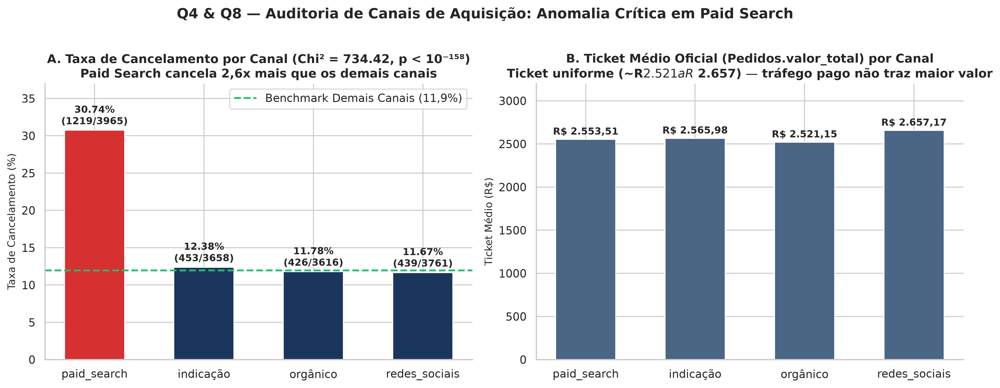
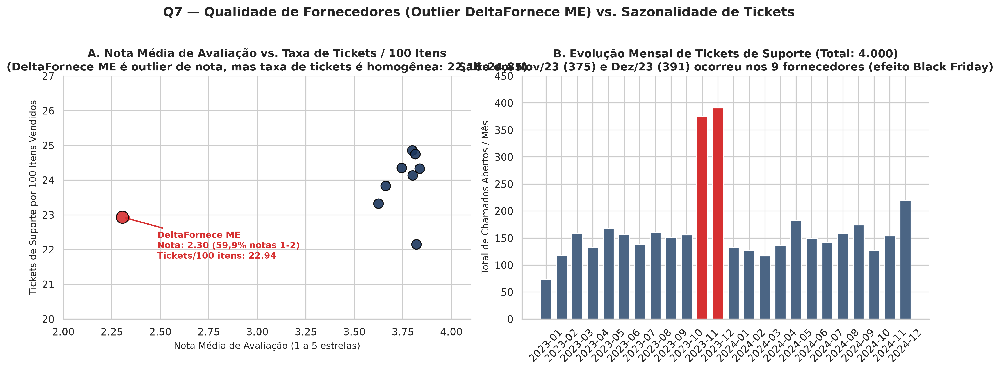

# OrbitShop — Due Diligence Analítica Series C
**Case Técnico: Peers Consulting & Technology**


Repositório auditável contendo o diagnóstico técnico, financeiro e operacional completo da **OrbitShop** (operação de e-commerce 2023–2024) para suporte à tomada de decisão do **Comitê de Investimento Series C**.

---

## 1. Guia de Execução Rápida (Reprodutibilidade em 1 Comando)

O projeto utiliza gerência determinística de pacotes (`uv.lock` + `pyproject.toml`) e exporta `requirements.txt` para compatibilidade universal.

### Opção A — Pipeline Completo via `Makefile` (Recomendado)
```bash
# Instala dependências, roda a suíte pytest, gera os 5 gráficos (300 DPI) + PDF do Memo
# e executa inplace o Notebook Executivo (02_analise_executiva.ipynb / analise_orbitshop.ipynb)
make all
```

Comandos granulares disponíveis:
```bash
make setup      # Provisiona o ambiente virtual (.venv) via uv sync
make test       # Executa a suíte de testes automatizados (pytest -v)
make reproduce  # Roda testes + regenera figuras 300 DPI/PDF + executa o notebook via nbconvert
```

### Opção B — Execução Direta via `uv` ou `pip`
```bash
# Via uv:
uv sync
uv run pytest -v
uv run python -m src.charts
uv run jupyter nbconvert --to notebook --execute --inplace notebooks/02_analise_executiva.ipynb

# Via pip tradicional:
python3 -m venv .venv && source .venv/bin/activate
pip install -r requirements.txt
pytest -v
```

---

## 2. Arquitetura do Repositório

```text
orbitShopCaseSolution/
├── README.md                                      # Documentação executiva, guia de execução e rastreabilidade Q1–Q9
├── Makefile                                       # Automação em 1 comando (make setup, make test, make reproduce, make all)
├── pyproject.toml                                 # Configuração do projeto, dependências e linter (Ruff / Pytest)
├── uv.lock                                        # Lockfile determinístico de dependências
├── requirements.txt                               # Dependências pinadas para ambientes pip padrão
├── data/
│   └── Base_Dados_OrbitShop.xlsx                  # Base bruta oficial imutável (6 abas transacionais + Leia-me)
├── src/
│   ├── __init__.py
│   ├── loader.py                                  # Ingestão tipada, validação de schema e auditoria de PKs/FKs (Q1)
│   ├── audit.py                                   # Auditoria de nulos, regras comerciais e reconciliação financeira (Q1, Q6)
│   ├── metrics.py                                 # Cálculo determinístico das métricas de negócio (Paradoxo C-Level, Q2–Q8)
│   └── charts.py                                  # Geração dos 5 gráficos estáticos PNG (300 DPI) e renderização do Memo PDF
├── notebooks/
│   ├── 01_eda_auditoria_exploratoria.ipynb        # [IMUTÁVEL] Rascunho exploratório inicial de descoberta e EDA
│   ├── 02_analise_executiva.ipynb                 # [PRINCIPAL] Notebook executivo limpo e executado importando src/
│   └── analise_orbitshop.ipynb                    # Cópia sincronizada do notebook executivo (compatibilidade com PRD)
├── reports/
│   ├── memo_orbitshop.md                          # Memo Executivo de 1 página para o Board (<= 400 palavras)
│   ├── memo_orbitshop.pdf                         # Memo Executivo renderizado em PDF A4 de 1 página
│   └── figures/                                   # 5 figuras estáticas PNG em 300 DPI prontas para publicação
│       ├── q2_status_pedidos.png
│       ├── q4_cancelamento_canais.png
│       ├── q5_serie_mensal_2023_2024.png
│       ├── q6_reconciliacao_b2b_b2c.png
│       └── q7_fornecedores_qualidade_tickets.png
└── tests/
    ├── __init__.py
    └── test_metrics.py                            # 12 testes unitários e de entregáveis validando todos os invariantes Q1–Q9
```

---

## 3. Resumo Executivo & Decisão de Fonte da Verdade Financeira (Q1 & Q6)

A primeira etapa da Due Diligence auditou a consistência entre o cabeçalho de pedidos (`Pedidos`, 15.000 linhas) e os itens transacionais (`Itens_Pedido`, 36.740 linhas):

1. **Divergência Irreconciliável (`0 de 14.921` pedidos conciliam):** A soma oficial de `Pedidos.valor_total` nos 14.921 pedidos válidos é **R$ 38.418.252,65**, enquanto a soma líquida calculada via `Itens_Pedido` atinge **R$ 165.878.066,67** (uma inflação artificial de **+R$ 127.459.814,02**, ou 4,3x superior). Nem mesmo os **4.790 pedidos de 1 único item** conciliam (`0` conciliações).
2. **Prova pela Premissa de Negócio da CEO (Segmentação B2B vs. B2C):**
   - Em `Pedidos.valor_total`, o ticket médio **B2B é R$ 7.778,34** (mediana **R$ 7.803,97**) contra **R$ 1.264,72** no **B2C** (mediana **R$ 1.255,37**), confirmando uma razão de **6,15x** alinhada à operação comercial.
   - Em `Itens_Pedido`, a média por pedido é indiferenciada entre **B2B (R$ 11.095,85)** e **B2C (R$ 11.049,17 — razão 1,00x)**, com correlação nula ($r = -0,0006$), além de **34.148 itens (92,95%)** com preço divergente do catálogo, **2.574 (7,01%)** abaixo do custo unitário e **21.243 (57,82%)** com desconto aplicado sem cupom.
3. **Regra de Governança Adotada:**
   - **`Pedidos.valor_total`** é a **única fonte da verdade para Receita e Ticket Médio** (imputando os 79 nulos pela mediana do respectivo segmento B2B/B2C -> total imputado de **R$ 38.626.862,55**).
   - **`Itens_Pedido`** é utilizada exclusivamente para análises de **volume físico (`quantidade`)**, **mix relativo entre categorias (Q3)** e **vínculo produto-fornecedor para avaliações e suporte (Q7)**.

---

## 4. Tabela de Rastreabilidade Completa (Q1 a Q9)

| Questão / Tópico | Diagnóstico Quantitativo Auditado | Módulo / Função (`src/`) | Teste Automatizado (`tests/test_metrics.py`) | Artefato Visual / Relatório |
| :--- | :--- | :--- | :--- | :--- |
| **Q1** — Integridade, Nulos e Anomalias | 0 duplicatas de PK e 0 FKs órfãs nas 6 abas. Nulos: `Pedidos.valor_total` (79 = 0,53%), `Itens_Pedido.desconto_aplicado` (1.839 = 5,01%), `Tickets_Suporte.data_resolucao` (418 = 10,45%), `Avaliacoes.comentario` (1.825 = 22,81%). Anomalias em itens: 34.148 preços != catálogo, 2.574 abaixo do custo, 21.243 descontos sem cupom. | `loader.audit_primary_keys`, `loader.audit_relational_integrity`, `audit.audit_nulls`, `audit.audit_commercial_rules` | `test_schema_and_row_counts`, `test_relational_integrity`, `test_null_counts_and_percentages`, `test_commercial_rule_anomalies` | Seção 1 do Notebook Executivo |
| **Paradoxo C-Level** (Camila vs. Rogério) | Taxa de cancelamento estrutural de **16,91%** (2.536/15.000), estável entre 2023 (**16,78%**) e 2024 (**17,08%**). Queda de volume bruto em 2024 deve-se à não repetição da Black Friday de nov/2023. | `metrics.metrics_camila_vs_rogerio` | `test_camila_vs_rogerio_paradox` | Seção 3 do Notebook Executivo |
| **Q2** — Funil de Status de Pedidos | `entregue`: 9.959 (**66,39%** / R$ 25,28M); `cancelado`: 2.536 (**16,91%** / R$ 6,47M); `em_transito`: 1.372 (**9,15%** / R$ 3,66M, sendo **788 presos de 2023**); `devolvido`: 1.133 (**7,55%** / R$ 3,00M). Não-convertidos = **24,46% (3.669 pedidos / R$ 9,47M)**. | `metrics.metrics_q2_status`, `charts.plot_q2_status` | `test_q2_status_distribution` | `reports/figures/q2_status_pedidos.png` |
| **Q3** — Mix de Categorias (Volume vs. Receita) | Top 3 em volume físico: `Eletrônicos` (18.658 un.), `Casa & Decoração` (17.899 un.) e `Moda` (15.680 un.). `Moda` cai para **5º lugar em receita líquida** (atrás de `Beleza & Saúde` e `Esporte & Lazer`) pelo menor preço médio praticado (**R$ 1.347,98**). | `metrics.metrics_q3_categories` | `test_q3_categories` | Seção 4 do Notebook Executivo |
| **Q4** — Canais de Aquisição | `paid_search` tem **30,74% de cancelamento** (1.219/3.965), concentrando **48,07%** de todos os cancelamentos contra **11,67%–12,38%** nos demais 4 canais ($\chi^2 = 734,42, p = 7,22 \times 10^{-159}$), com ticket médio uniforme (**R$ 2.553,51**). | `metrics.metrics_q4_channels`, `charts.plot_q4_channels` | `test_q4_acquisition_channels` | `reports/figures/q4_cancelamento_canais.png` |
| **Q5** — Série Mensal 2023–2024 e Sazonalidade | Média basal estável de **551 pedidos/mês** (23 meses). Pico isolado em **`2023-11` com 2.317 pedidos (4,20x a média)**, simétrico entre `app` (783), `site` (770) e `marketplace` (764), não repetido em **`2024-11` (585 pedidos)**. | `metrics.metrics_q5_monthly`, `charts.plot_q5_monthly` | `test_q5_monthly_evolution` | `reports/figures/q5_serie_mensal_2023_2024.png` |
| **Q6** — Reconciliação Pedidos vs. Itens | 0 de 14.921 pedidos conciliam (R$ 38,42M vs. R$ 165,88M; diferença de -R$ 127,46M). Ticket B2B (**R$ 7.778,34**) é **6,15x** B2C (**R$ 1.264,72**) em `Pedidos`, mas 1,00x em `Itens_Pedido`. | `audit.reconcile_orders_vs_items`, `audit.audit_q6_by_segment`, `charts.plot_q6_reconciliation` | `test_q6_reconciliation_and_segment_validation` | `reports/figures/q6_reconciliacao_b2b_b2c.png` |
| **Q7** — Fornecedores vs. Operação de Suporte | `DeltaFornece ME` é outlier exclusivo de avaliação (nota **2,30**; **59,90%** notas 1–2 vs. **3,62–3,84** dos pares), mas sua taxa de suporte é normal (**22,94 tickets/100 itens** vs. **22,16–24,85**). O salto em nov/2023 (**375**) e dez/2023 (**391**) foi sistêmico pós-Black Friday. | `metrics.metrics_q7_suppliers`, `charts.plot_q7_suppliers` | `test_q7_suppliers_and_support` | `reports/figures/q7_fornecedores_qualidade_tickets.png` |
| **Q8** — Recomendação Prioritária Única | Reestruturar o funil de `paid_search`: reduzir cancelamento de **30,74%** para o benchmark dos demais canais (**11,9%**) recupera **~747 pedidos** e **~R$ 1,91M em receita bruta** sem elevar CAC. | `metrics.metrics_q8_recommendation` | `test_q8_recommendation_sizing` | Seção 8 do Notebook Executivo |
| **Q9** — Síntese Executiva para o Comitê Series C | Memo Executivo de 1 página (`<= 400` palavras) consolidando governança de dados, alavanca de R$ 1,91M em `paid_search`, SLA com `DeltaFornece ME` e baixa dos 788 pedidos `em_transito` de 2023. | `charts.render_memo_pdf` | `test_phase2_deliverables_and_memo_constraints` | [`reports/memo_orbitshop.md`](reports/memo_orbitshop.md) / [`reports/memo_orbitshop.pdf`](reports/memo_orbitshop.pdf) |

---

## 5. Visualizações Executivas (300 DPI)

### 5.1 (Q6) Reconciliação Financeira e Validação de Segmento B2B vs. B2C


### 5.2 (Q2) Funil de Status de Pedidos e Erosão de Receita Não Convertida


### 5.3 (Q4) Auditoria de Canais de Aquisição — Anomalia em `paid_search` (30,74%)


### 5.4 (Q5) Evolução Mensal (2023–2024) e Pico Isolado da Black Friday Nov/2023


### 5.5 (Q7) Qualidade de Fornecedores (`DeltaFornece ME`) vs. Chamados de Suporte

